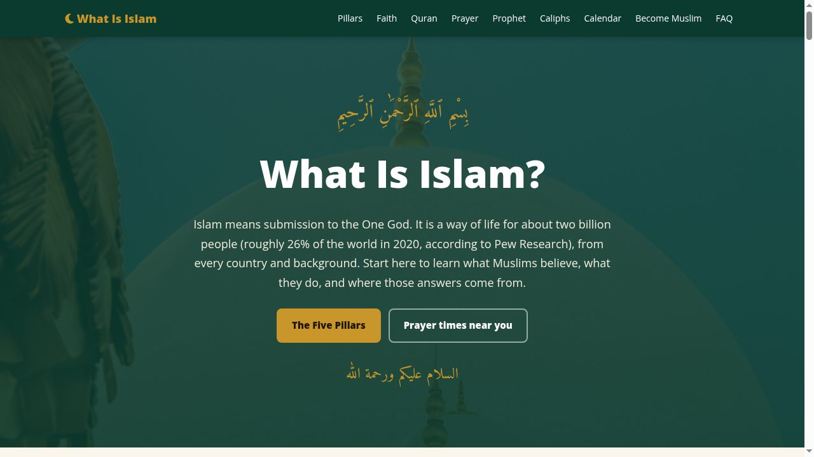

# What Is Islam?

An introduction to Islam in plain English, with sources: what Muslims believe, how they worship, the life of the Prophet, and answers to common questions.

**Read it:** https://mhmd7710d.github.io/What-is-Islam/

## What's inside
- The short answer, then the Five Pillars of Islam and the Six Articles of Faith.
- The Quran, prayer (salah), and zakat, Ramadan and Hajj in more detail.
- The life of the Prophet Muhammad and the rightly-guided caliphs.
- The Islamic calendar, how someone becomes a Muslim, and common questions.
- Prayer times by city, and a sources section listing the references used.

## Built with
HTML, CSS and a little JavaScript for the mobile menu and the prayer times. The layout started from Elzero Web School's Template Two (Kasper) and was rebuilt with this content.

## Note
The contact form is layout only and does not send messages. The content is written for learning, from mainstream Sunni sources; for religious rulings, ask a qualified scholar.

## Run it locally
Download the repository and open `index.html` in a browser.

## Credits
Layout: Elzero Web School, Template Two (Kasper). Content, copy and design changes: Mohammad Fathi.

## Contact
- LinkedIn: https://www.linkedin.com/in/muhammad-fathi-b7a693424/
- X (Twitter): https://x.com/mouahid7710
- Facebook: https://www.facebook.com/share/1CQhxpCeYL/
- Instagram: https://www.instagram.com/mhmd7710d/
- Email: muhammutfathi@gmail.com
- WhatsApp: https://wa.me/201040428475?text=Hi+Mohammad%2C+I+found+your+project+on+GitHub.
